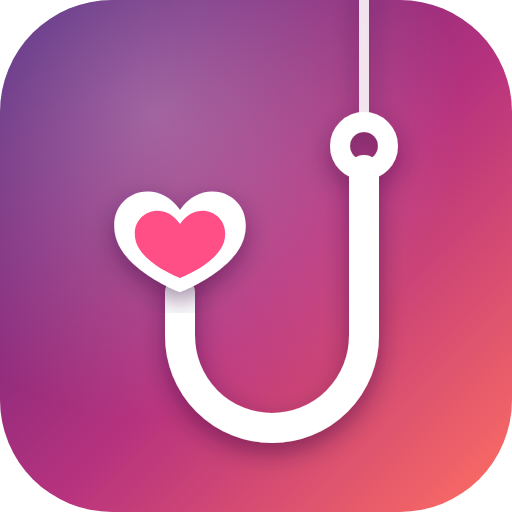

<p align="center"></p>

<h1 align="center">The Hook-Up: restored</h1>

<p align="center">
  A lost 2007 Flash dating and social sim, brought back to life and fully playable on Windows and the Steam Deck.<br>
  <a href="https://thehookuprevived.pages.dev"><b>Play in your browser</b></a> · <a href="https://github.com/Cyberhex1/the-hook-up/releases/latest"><b>Download the latest release</b></a>
</p>

---

*The Hook-Up* (THUP Games for TheN.com, v1.5.2) was a browser game where you move to a new town, make friends, go on dates and build relationships through conversation. It saved games to TheN.com's servers. When those servers shut down, saving broke, and in the surviving copies, clicking Save left the page and wiped your progress.

This project reverse-engineers the original ActionScript 2 game and patches it to save locally. It fixes the bugs that froze the game, and it packages everything as a standalone desktop app. You don't need Flash, a browser or an internet connection.

## Features

- **Working saves:** three slots, an autosave every in-game morning, and a slot picker inside the game. The original save format is kept, and only how saves are stored was replaced.
- **Crash-safe save files:** the game writes saves to a JSON file next to it, never leaves a half-written file if it crashes, and keeps the last 30 versions as backups. Saves can be exported from the web version and imported into the desktop one, and the other way around.
- **Bug fixes:** a duplicate init, leaked load-state timers and event listeners, info prompts that unfroze the game mid-event, and appointments that blocked saving.
- **Steam Deck ready:** a native Linux build, a pointer you move with the controller, an on-screen keyboard and a pause menu. Touchscreen and trackpads work too.
- **Two ways to play:** the website [TheHookupRevived](https://thehookuprevived.pages.dev) and a standalone app (Electron 44 + Ruffle 0.7.1).
- **Saves you control on the website:** saves stay in your browser on your own PC or Steam Deck. Each change is kept in a backup history you can download or restore from. One click downloads a full backup. In Chrome and Edge you can also link a folder on your computer, and every save is written there as a file. The website has a full-screen mode and a settings menu: volume, mute or pause when you switch away, graphics quality, stretch-to-fill, panel layout, how many backups to keep, and backup reminders.

## Download

| Build | Platform |
|---|---|
| [`TheHookUp-1.0-SteamDeck.tar.gz`](https://github.com/Cyberhex1/the-hook-up/releases/latest) | Steam Deck / Linux x64 (native) |
| [`TheHookUp-1.0-Windows.zip`](https://github.com/Cyberhex1/the-hook-up/releases/latest) | Windows (also runs on the Deck through Proton) |

Setup steps, including how to add it to Steam, are in the `README.txt` inside each package.

## How it works

- `patch/`: the AS2 script and XML content patches applied to the original SWF.
- `tools/`: the build pipeline. It fetches the pinned dependencies (Ruffle, the FFDec decompiler), patches and recompiles `hookup.swf`, and writes `dist/`.
- `web/`: the browser player, including save export and import.
- `site/`: the TheHookupRevived website (Cloudflare Pages): the player page, the save manager and the backups.
- `1.0/`: the standalone Electron wrapper and its packaging for Windows and Linux.
- `PLAN.md`: the investigation, from disassembling the save system to tracking down the freeze.

```bash
python -I tools/fetch_deps.py
python -I "1.0/build.py"
```

To build the website and upload it to Cloudflare Pages (needs `npx wrangler login` once):

```bash
python -I tools/build_site.py --deploy
```

## Credits

*The Hook-Up* and its art, music and writing belong to their original creators at THUP Games and TheN.com. This is a non-commercial fan preservation project. The restoration patches, tooling and desktop wrapper are by [Cyberhex1](https://github.com/Cyberhex1).
